# Software Renderer

## Overview

This program consists of a software renderer along with a custom-made GUI library used for manipulating the scene. The user can create a scene consisting of the provided 3D models. Textures and normal maps may also be applied to these models, and the models' materials may be altered as well. The user may also alter the scene's lighting, switching between directional and point lights or enabling shadows.

Included as well is a Python script for converting between this program's custom MDL file format and OBJ files. The GUI consists of a font renderer along with elements such as textboxes, buttons, checkboxes, sliders, and tabs.

  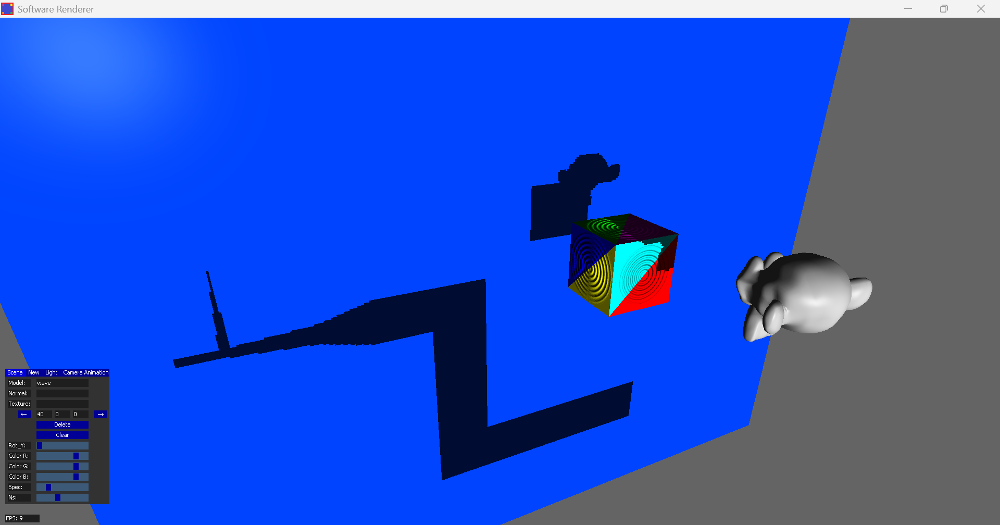

## Examples

The following table shows some examples of the scenes the user can construct with the provided models:

<table>
  <tr>
    <td align="center">
      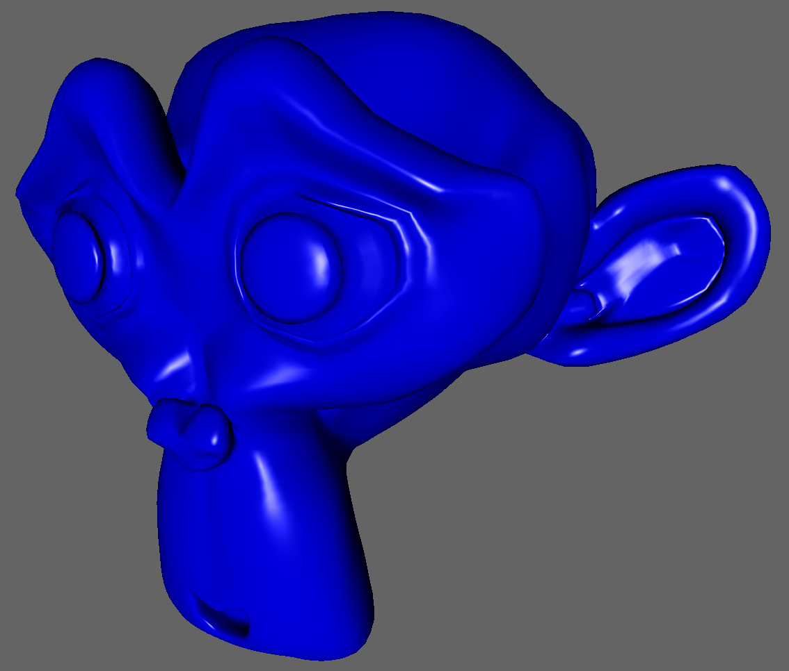 
    </td>
    <td align="center">
      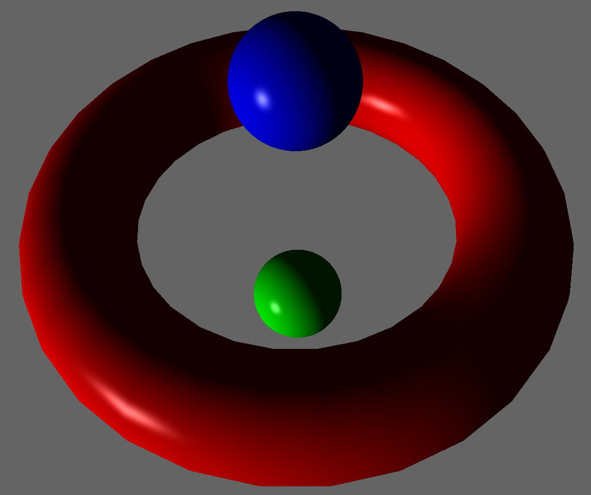 
    </td>
    <td align="center">
      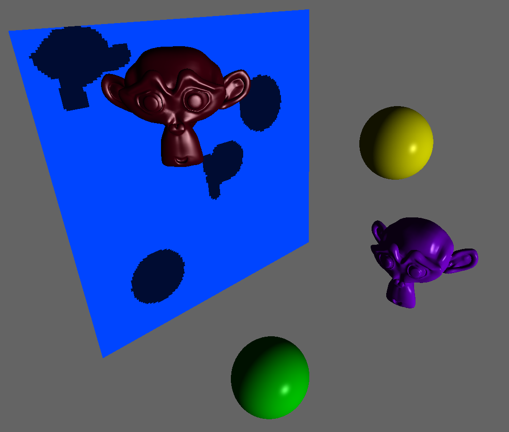 
    </td>
  </tr>
</table>

## Interface

The interface consists of five tabs, Scene, New, Light, Camera, and animation which enable the user to manipulate various elements in the scene.

### Scene

  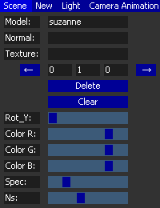

The Scene tab enables the user to view and alter any of the elements in the current scene. With the two arrow buttons, the user can traverse all models in the scene, ordered by when they were added; information such as the model's name, assigned normal map or texture, position (indicated by the three textboxes between the two arrow buttons), and material properties is updated accordingly.

As the user traverses the scene, individual models can be removed using the delete button, and the entire scene can be cleared with the clear button. Below the clear button are six sliders for editing the selected model's properties. They have the following functions:

- **Rot_Y**: Controls the model's rotation about it's y-axis
- **Color_R**: Controls the red component of the model's material
- **Color_G**: Controls the green component of the model's material
- **Color_B**: Controls the blue component of the model's material
- **Spec**: Controls the brightness of the model's specular highlights
- **Ns**: Controls the specular exponent, which determines the size of the specular highlights

### New

  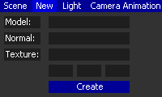

The New tab enables the user to add new models to the scene. The user can choose any model within the models folder and can also apply any texture or normal map from the textures folder. Not all models support textures or normal maps, and textures are currently only visible when lighting is disabled.

The models are stored using a custom MDL file format; OBJ files can be converted to MDL files using the provided `model_converter.py` script. Textures and normal maps are stored as BMP files. Above the create button, which adds the model to the scene, are three textboxes; here the user can input the desired X,Y,Z position for the model. These values must be integers.

### Light

  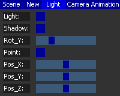

The Light tab enables the user to alter aspects of the scene's lighting. The light checkbox toggles lighting on and off. The shadow checkbox toggles shadows on and off. With the Rot_Y slider, the user can control the directional light's rotation about its y-axis.

  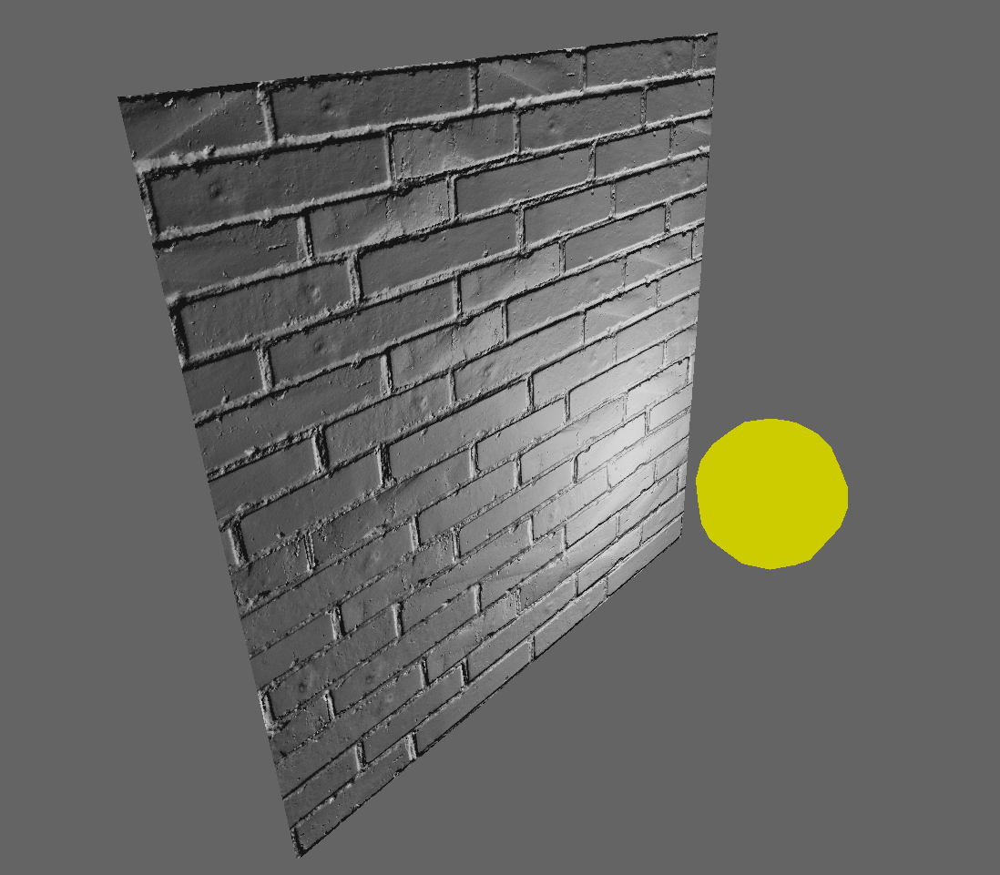

In addition to the directional light, the user can also enable a point light. This can be activated using the point checkbox; doing so disables the directional light. There are three sliders with which the user can shift the point light's position. Its initial position is off to the left of the camera's initial starting area; due to the short rendering distance (necessary for the shadows to render properly), the point light may not be visible right away.

### Camera

  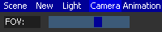

The Camera tab enables the user to alter aspects of the camera. Currently, the only thing that can be changed is the camera's field of view.

### Animation

  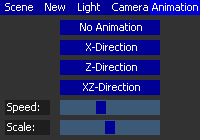

The Animation tab enables the user to animate one specific model. Included in the models folder is a model named wave. The user can pick from three different animation styles, and these will apply to all instances of the wave model in the scene. In the scene's initial layout, there is a wave model located up and off to the right from the starting position. Below are examples of the three different animation styles that can be applied:

<table>
  <tr>
    <td align="center">X-Direction</td>
    <td align="center">Z-Direction</td>
    <td align="center">XZ-Direction</td>
  </tr>
  <tr>
    <td align="center">
      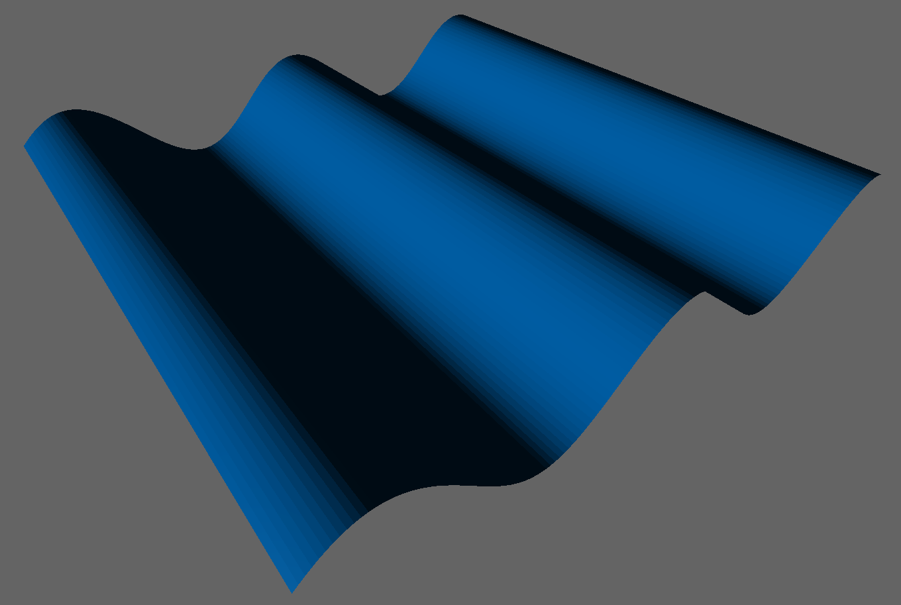 
    </td>
    <td align="center">
      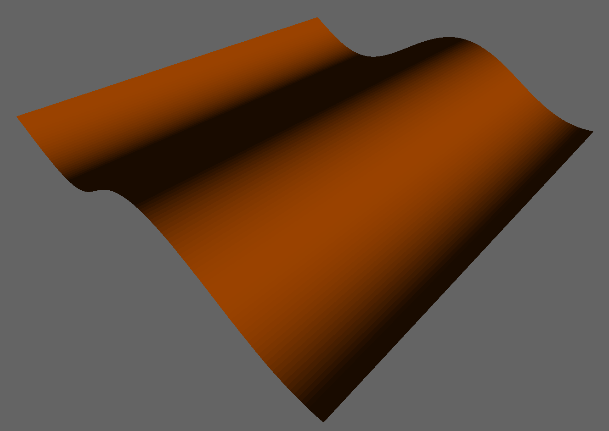 
    </td>
    <td align="center">
       
    </td>
  </tr>
</table>

The speed slider controls how fast the animation proceeds; as the slider is moved further to the right, the animations slows down. The scale slider controls the frequency of the waves; as the slider is moved further to the right, the frequency increases.

  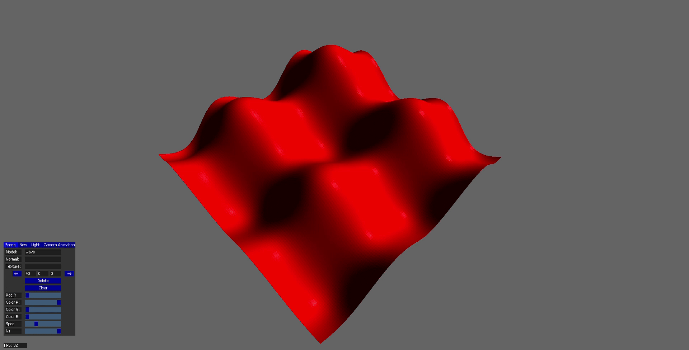

## Controls

Note that the camera cannot be moved while the GUI is visible.

| Key | Action |
| :---: | :---: |
| S | Move backwards |
| W | Move forwards |
| A | Move left |
| D | Move right |
| Left Shift | Move down |
| Space | Move up |
| Escape | Toggle GUI |
| Enter | Reset position |
| Mouse | Move camera |
